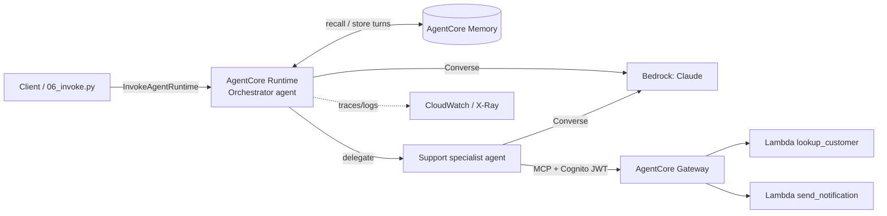

# Multi-Agent Support System on Amazon Bedrock + AgentCore

| Item | Value |
|---|---|
| AWS region | `us-east-1` |
| Foundation model | Claude Sonnet 4.5 on Bedrock, inference profile `us.anthropic.claude-sonnet-4-5-20250929-v1:0` (set via `MODEL_ID`) |
| Runtime | Amazon Bedrock AgentCore Runtime (container built by starter toolkit) |
| Tools | AgentCore Gateway -> 2 Lambdas: `lookup_customer`, `send_notification` |
| Memory | AgentCore Memory (short-term events + semantic long-term facts) |
| Identity | Cognito client-credentials JWT validated by the Gateway (scoped principal) |
| Observability | ADOT -> CloudWatch GenAI Observability / X-Ray traces + JSON logs |

## Status: what was and wasn't tested live
| Part | Status |
|---|---|
| Tool Lambda handlers (`tools/`) | Unit-tested locally (`pytest tests`) |
| Full flow in **mock mode** (`scripts/run_local.py`) | Runs offline: orchestrator -> specialist -> both tools, session memory, trace-style logs |
| AWS code (`agents/orchestrator.py`, `scripts/01-06`) | **Written but not deployed or run against AWS.** The AWS account available for this assignment (Free Plan) blocked Lambda, Cognito, Bedrock and AgentCore, so the Bedrock, AgentCore Runtime/Gateway/Memory and CloudWatch trace parts are untested. API parameters may need small fixes on first real deploy. |

To deploy for real, follow [docs/deployment.md](docs/deployment.md).

## Quick start (no AWS needed)
```bash
python3 -m venv .venv && source .venv/bin/activate
pip install -r requirements.txt
pytest tests
python scripts/run_local.py     # mock mode: shows the flow, memory recall and a trace per request
```
Mock mode uses a rule-based stand-in for the model and an in-process memory; it exists only to demonstrate the flow offline.

## Use case
A customer-support assistant. Example: "Look up customer C-1001 and email them that their ticket is resolved." The orchestrator hands this to a support specialist, which calls `lookup_customer` then `send_notification` through the Gateway. A follow-up in the same session ("notify that customer again") is answered using memory. Data is mocked; real handlers would hit a CRM and SES/SNS.

## Agent flow

1. Client invokes the Runtime with a `session_id` and `actor_id`.
2. Orchestrator loads prior turns/facts from Memory, then delegates customer questions to the specialist agent.
3. Specialist gets a Cognito token, lists Gateway tools over MCP, calls `lookup_customer` / `send_notification`.
4. Answer is returned and the turn is written back to Memory.

## Real deployment, observability, cleanup
See [docs/deployment.md](docs/deployment.md) for IAM roles, script order, invocation, where to find the CloudWatch trace, and cleanup. Architecture rationale: [docs/ARCHITECTURE.md](docs/ARCHITECTURE.md).

## Security
No credentials are committed. `.env` is gitignored; `.env.example` has placeholders. Use IAM roles / SSO.
